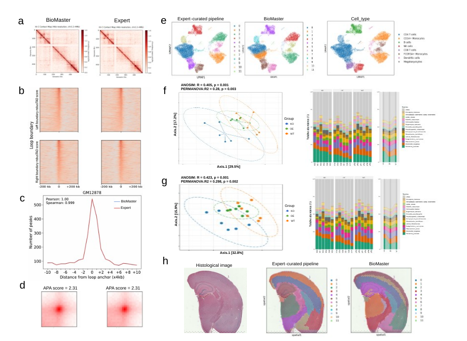
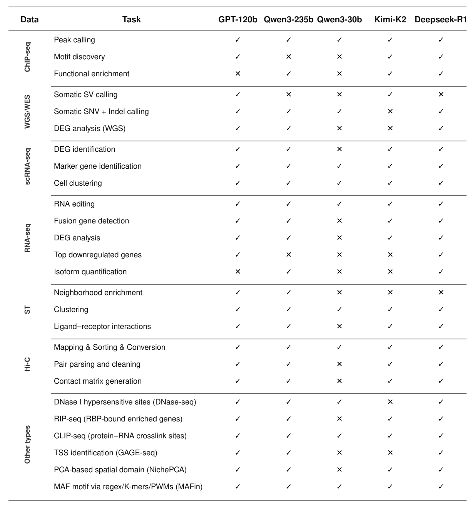
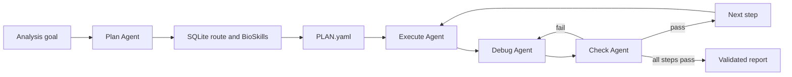

<div align="center">
  

  <h1>BioMaster</h1>

  <p><strong>A multi-agent system for automated bioinformatics analysis workflows</strong></p>

  <p>
    <a href="https://doi.org/10.1016/j.patter.2026.101611">
      
    </a>
    <a href="https://github.com/ai4nucleome/BioMaster/tree/master">
      
    </a>
    <a href="https://github.com/ai4nucleome/BioMaster/tree/v2.0-alpha1">
      
    </a>
  </p>
</div>

## News

- **July 2026** — The BioMaster article, [*BioMaster: Multi-agent system for automated bioinformatics analysis workflow*](https://doi.org/10.1016/j.patter.2026.101611), was published in **Patterns**.
- **Project website** — Explore the BioMaster system, benchmark, team, and documentation at <https://ai4nucleome.github.io/BioMaster/>.
- **BioMaster v2.0-alpha1** — BioMaster has been upgraded on top of [OpenCode](https://github.com/anomalyco/opencode) with an interactive workspace, role-isolated BioSkills, SQLite-backed retrieval, and stricter workflow validation.

If you use BioMaster in academic work, please cite our *Patterns* article. See [Citation](#citation) or use GitHub's **Cite this repository** button.

## About BioMaster

BioMaster converts a natural-language analysis objective into an executable and auditable bioinformatics workflow. Instead of relying on one agent for a long chain of decisions, BioMaster assigns planning, execution, debugging, and output verification to specialized agents. Curated domain knowledge is retrieved only when it is relevant to the current workflow phase.

The system is designed for multi-step analyses across RNA-seq, ChIP-seq, single-cell and spatial omics, Hi-C, long-read sequencing, metagenomics, proteomics, and related workflows. In the evaluation reported in the paper, BioMaster completed 47 of 49 benchmark tasks across 102 bioinformatics tools.

> BioMaster assists workflow design and execution; it does not replace expert review. Inspect generated commands, reference resources, statistical assumptions, and biological conclusions before using results in production or clinical settings.

<p align="center">
  
  
</p>

## Which Version Should I Use?

This repository preserves two generations of BioMaster:

| Branch | Purpose |
| --- | --- |
| [`master`](https://github.com/ai4nucleome/BioMaster/tree/master) | Original implementation corresponding to the experiments and architecture described in the *Patterns* paper |
| [`v2.0-alpha1`](https://github.com/ai4nucleome/BioMaster/tree/v2.0-alpha1) | Current OpenCode-based preview with a redesigned UI, BioSkills knowledge layer, SQLite control plane, and stronger runtime gates |

Use `master` when reproducing the published implementation. Use `v2.0-alpha1` to try the new interactive BioMaster experience.

## What's New in v2.0-alpha1

- **OpenCode-based interface** — chat, project files, terminals, workflow status, and BioSkills management in one workspace.
- **Four-agent workflow** — Plan coordinates the conversation while Execute, Debug, and Check handle each approved step.
- **BioSkills library** — file-backed workflow and tool knowledge synchronized into SQLite for deterministic retrieval.
- **Role isolation** — workflow Skills are available only to Plan; execution Skills are available only to Execute, Debug, and Check.
- **Skill activation controls** — disabled Skills remain visible in the management page but are immediately excluded from Agent and SQLite retrieval.
- **Runtime Hard Gates** — route selection, phase transitions, upstream checks, and reporting readiness are enforced by code rather than prompt instructions alone.
- **Auditable project artifacts** — plans, commands, logs, checks, and reports are stored under a semantic project directory.
- **Validated YAML state** — core workflow documents are schema-checked and written atomically.

## Workflow



For every planned step, BioMaster follows:

```text
Execute(step N) → Debug(step N) → Check(step N)
```

The next step cannot begin until the current step passes Check. Reporting is blocked while any required output is missing or invalid.

## Repository Structure

```text
BioMaster/
├── .opencode/
│   ├── agents/                  Plan, Execute, Debug, Check, and Skill agents
│   ├── commands/                /biomaster-* workflow commands
│   ├── skills/biomaster/        public BioMaster entry point
│   ├── bioskills/               curated workflow and execution knowledge
│   ├── knowledge/               generated SQLite cache location
│   ├── runtime/biomaster/       workflow, retrieval, validation, and reporting
│   └── tools/                   BioSkills tools exposed to OpenCode
├── BioMaster/
│   └── packages/
│       ├── opencode/            BioMaster/OpenCode server
│       └── app/                 web interface
├── docs/                        project website
├── examples/                    smoke and knowledge-control examples
├── source/                      logo, UI, and publication figures
├── install.sh                   first-time installation
├── run.sh                       local and remote launcher
├── Makefile                     validation and maintenance commands
└── CITATION.cff                 citation metadata
```

Runtime analyses are created under `projects/<project_slug>/` and are not part of the source release.

## Installation

### Requirements

- Linux (recommended and tested); macOS may work but is not currently part of release validation
- Git and `curl`
- Python 3.10 or newer
- Node.js 22 and Bun 1.x
- Access to an LLM provider supported by OpenCode
- Bioinformatics software and reference data required by your analysis

The installer can provision compatible Node.js and Bun versions.

### 1. Clone the OpenCode-based preview

```bash
git clone --branch v2.0-alpha1 https://github.com/ai4nucleome/BioMaster.git
cd BioMaster
```

To reproduce the implementation associated with the paper instead:

```bash
git clone --branch master https://github.com/ai4nucleome/BioMaster.git
```

### 2. Install dependencies

```bash
./install.sh
```

The installer prepares Python dependencies, the embedded OpenCode workspace, and the BioMaster web application. For a clean reinstall:

```bash
./install.sh --clean
```

On networks where the default npm registry is slow:

```bash
BUN_REGISTRY=https://registry.npmmirror.com \
BUN_NETWORK_CONCURRENCY=12 \
./install.sh
```

### 3. Configure an LLM provider

Start BioMaster, open the provider settings in the web interface, and configure a supported provider and model. A reasoning-capable model is recommended for planning and debugging complex workflows.

Credentials should be configured through OpenCode's provider settings or environment integration. Do not commit API keys to this repository.

For the current BioMaster interface, the following settings are recommended:

- Turn **New layout and designs** off for the most stable BioMaster page layout.
- Turn **Auto-accept permissions** on to avoid repeated approval prompts while BioMaster loads Skills and runs its multi-agent workflow. Enable this only in a trusted project and environment, because tool requests will be approved automatically.

## Running BioMaster

### Local workstation

```bash
./run.sh local
./run.sh status
```

Open <http://127.0.0.1:4096> and select the cloned BioMaster repository as the project.

### Remote server

Bind to all interfaces only with authentication:

```bash
export OPENCODE_SERVER_PASSWORD="$(openssl rand -base64 24)"
./run.sh remote --password "$OPENCODE_SERVER_PASSWORD"
```

For temporary use in an isolated and trusted network, BioMaster can also be started without authentication:

```bash
./run.sh remote --unsafe
```

> **Security warning:** `--unsafe` exposes BioMaster without password protection to hosts that can reach the listening port. Do not use it on a public IP, shared network, or internet-facing server. Prefer password authentication or an SSH tunnel.

For HPC or institutional servers, keeping BioMaster on localhost and using an SSH tunnel is usually safer:

```bash
# Run on the server
./run.sh local

# Run on your local computer
ssh -L 4096:127.0.0.1:4096 <user>@<server>
```

Then open <http://127.0.0.1:4096> locally.

Use another port when 4096 is occupied:

```bash
./run.sh restart --host 127.0.0.1 --port 18080
```

## Tutorial: Your First Analysis

### 1. Start a project

In the BioMaster chat, enter:

```text
/biomaster-start Analyze tumor heterogeneity and cell-state trajectories in my scRNA-seq dataset
```

You can also start conversationally:

```text
/biomaster Analyze tumor heterogeneity and cell-state trajectories in my scRNA-seq dataset
```

Choose one of the presented modes:

- **Test mode** — explore BioMaster with lightweight or demonstration inputs.
- **Formal analysis** — run an analysis with your own data and explicit input contracts.
- **Custom objective** — formulate a workflow that may not match an existing route.

### 2. Provide the analysis context

For a formal analysis, BioMaster first asks for the objective and then for input details. Provide:

- absolute or project-relative input paths;
- file formats and reference genome/build;
- sample names, groups, and contrasts;
- metadata, phenotype, or clinical tables;
- expected outputs and important acceptance criteria;
- environment constraints such as CPU, memory, GPU, or scheduler requirements.

BioMaster searches existing projects before creating a new semantic project folder.

### 3. Review the plan

BioMaster retrieves a workflow route and authorized Skills from SQLite, then writes:

```text
projects/<project_slug>/PLAN.yaml
```

Review the proposed steps, required inputs, tools, expected outputs, and acceptance criteria. Request changes before execution if necessary.

### 4. Execute

After approving the plan:

```text
/biomaster-run
```

BioMaster requests confirmation once, then processes eligible steps in order. Each step is executed, debug-reviewed, and independently checked before the next step starts.

### 5. Resume, inspect, or recover

| Command | Purpose |
| --- | --- |
| `/biomaster-start [goal]` | Start mode selection and project routing |
| `/biomaster-plan <goal>` | Build or revise a SQLite-grounded plan |
| `/biomaster-run` | Execute the next eligible plan step |
| `/biomaster-check` | Re-check outputs and refresh reports |
| `/biomaster-debug` | Diagnose a failed step and prepare a bounded retry |
| `/biomaster-resume` | Continue or review an existing project |

### 6. Review the results

Each project contains:

```text
projects/<project_slug>/
├── PLAN.yaml           structured analysis plan
├── PROJECT_LOG.yaml    audited execution history and evidence
├── CHECK_REPORT.yaml   per-step verification status
├── REPORT.md           final readable report
├── OPENCODE_VIEW.md    compact project summary for the UI
├── scripts/            generated scripts grouped by step
├── steps/              execution logs and step results
└── artifacts/          analysis outputs
```

`REPORT.md` is produced only after all required checks pass.

## Managing BioSkills

Open the **BioSkills** page from the BioMaster interface to browse, search, create, edit, activate, or deactivate Skills.

Each Skill contains:

```text
SKILL.md      metadata and activation status
macro.md      workflow or conceptual description
micro.md      execution guidance, commands, and parameters
steps.json    structured step metadata
```

Skill access is fail-closed:

- `plan-*` workflow Skills: Plan Agent only;
- `exec-*` execution Skills: Execute, Debug, and Check Agents only;
- Skill-management agents: catalog metadata only;
- unknown agents: no Skill body access.

Turning a Skill off keeps its card visible for later reactivation but immediately excludes it from Agent retrieval and the SQLite knowledge path.

## Validation

Run the release checks after modifying runtime, Skill, or interface code:

```bash
make test
```

This validates the BioSkills library, rebuilds the generated SQLite cache, exercises workflow and knowledge-control examples, and runs compliance checks. Remove generated caches and run artifacts with:

```bash
make clean
```

## Troubleshooting

- **Commands are missing** — select the repository root containing `.opencode/`, then reload the project.
- **The browser is disconnected** — run `./run.sh status` and confirm the displayed port returns HTTP 200.
- **A shared server uses the same port** — restart with `--port <port>` and open that exact port.
- **A remote port cannot be reached** — use an SSH tunnel instead of exposing the service directly.
- **Dependencies are inconsistent** — run `./install.sh --clean`.
- **A newly edited Skill is not selected** — confirm it is active in the BioSkills page and run `make knowledge-seed`.
- **Logs are needed** — run `./run.sh logs`.

## Citation

Please cite:

```bibtex
@article{su2026biomaster,
  title     = {BioMaster: Multi-agent system for automated bioinformatics analysis workflow},
  author    = {Su, Houcheng and Feng, Junning and Lu, Yawen and Xu, Yucheng and Yang, Jinming and Lu, Haojie and Yang, Jixin and Yang, Xu and Xie, Sirui and Long, Weicai and Wang, Chengrui and Hou, Yusen and Zhu, Tingyu and Zhang, Yanlin},
  journal   = {Patterns},
  year      = {2026},
  pages     = {101611},
  publisher = {Elsevier},
  doi       = {10.1016/j.patter.2026.101611}
}
```

- Published article: <https://doi.org/10.1016/j.patter.2026.101611>
- bioRxiv preprint: <https://doi.org/10.1101/2025.01.23.634608>
- Citation metadata: [`CITATION.cff`](./CITATION.cff)

## Acknowledgments

BioMaster v2.0-alpha1 builds on OpenCode and the open-source bioinformatics ecosystem. We thank the contributors, tool developers, and research communities whose work makes automated and reproducible bioinformatics possible.

For questions or bug reports, please use [GitHub Issues](https://github.com/ai4nucleome/BioMaster/issues).
