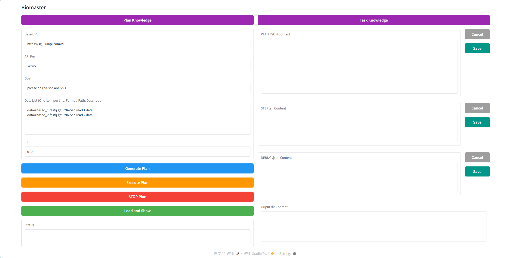

<div  align="center">    
 
</div>

# 🧬 BioMaster: Multi-agent System for Automated Bioinformatics Analysis Workflow

[](https://www.biorxiv.org/content/10.1101/2025.01.23.634608v1.abstract)

**BioMaster** is a sophisticated, multi-agent framework that leverages large language models (LLMs) and dynamic knowledge retrieval to automate and streamline complex bioinformatics workflows. Designed specifically to tackle the challenges of modern bioinformatics, BioMaster improves accuracy, efficiency, reproducibility, and scalability across diverse omics data types, including RNA-seq, ChIP-seq, single-cell analysis, spatial transcriptomics, and Hi-C data processing.

---
## News

- 2025-05-15: Update the code to support ollama.
- 2025-04-30: Update the code to support config.yaml to run the example.

## 🚀 Key Features

- **✨ Fully Automated Bioinformatics Pipelines**
  - Seamlessly automates data preprocessing, alignment, variant calling, and comprehensive downstream analysis.

- **🤖 Role-Based Multi-Agent System**
  - Specialized agents (Plan, Task, Debug, and Check Agents) collaboratively handle task decomposition, execution, validation, and error recovery.

- **📚 Dynamic Retrieval-Augmented Generation (RAG)**
  - Dynamically retrieves and integrates domain-specific knowledge, allowing BioMaster to adapt rapidly to emerging bioinformatics tools and specialized workflows.

- **🔍 Advanced Error Handling & Recovery**
  - Robust error detection and automated debugging mechanisms minimize propagation of errors across workflow steps, ensuring reliability and reproducibility.

- **🧠 Optimized Memory Management**
  - Efficiently manages memory, enabling stable and consistent performance even in complex, long-running workflows.

- **⚙️ Extensible & Customizable**
  - Supports easy integration of custom bioinformatics tools, scripts, and workflows, empowering researchers to extend BioMaster according to their specific analysis needs.

- **🖥️ Interactive UI**
  - User-friendly graphical interface allows users without extensive computational expertise to effortlessly manage, execute, and monitor bioinformatics workflows.

---
## 📌 Supported Bioinformatics Workflows

BioMaster autonomously handles a diverse range of bioinformatics analyses across multiple omics modalities:

### 🧬 **RNA-seq Analysis**
- DEG analysis (Differentially Expressed Genes)
- DEG analysis (WGS-based)
- Fusion gene detection
- APA analysis (Alternative Polyadenylation)
- RNA editing
- Splicing analysis
- Expression quantification
- Novel transcript identification
- Functional enrichment
- Circular RNA identification

### 🔬 **ChIP-seq Analysis**
- Peak calling
- Motif discovery
- Functional enrichment

### 🧫 **Single-cell RNA-seq (scRNA-seq)**
- DEG analysis
- Marker gene identification
- Cell clustering
- Top marker genes identification

### 🗺️ **Spatial Transcriptomics**
- Neighborhood enrichment
- Cell type annotation
- Spatially Variable Gene (SVG) detection
- Clustering
- Ligand-Receptor interactions

### 🧩 **Hi-C Data Processing**
- Mapping & sorting conversion
- Pair parsing & cleaning
- Contact matrix generation

### 🧪 **Nanopore Sequencing**
- DNA methylation identification
- De novo assembly
- Alignment
- Quality control
- Host removal
- Transcript quantification analysis
- Isoform quantification (RNA-seq)

### 📌 **microRNA Analysis**
- microRNA prediction
- microRNA quantification

### 📂 **Other Specialized Data Types**
- DNA methylation (Bisulfite-Seq)
- DNase-seq hypersensitive site identification
- PAS (Polyadenylation Site) identification (3’end-seq)
- Protein-RNA cross-links identification
- Ribo-seq analysis (RBP-bound enriched genes)
- Metagenomic analysis and composition plotting
- TSS identification (CAGE-seq)
- Protein expression quantification
- Isoform quantification for PacBio RNA-seq
- Translated ORFs identification (Ribo-seq)

---
## 📖 Documentation

You can find the read the doc documentation in the [docs](https://biomaster.readthedocs.io/en/latest/) folder.

## 📖 Installation

You can install BioMaster using the following steps:

1. Clone the repository:

```sh
git clone https://github.com/yourusername/BioMaster.git
cd BioMaster
```

2. Install the required dependencies:

```sh
conda create -n agent python=3.12
# you can install other version of python,suggest use 3.10-3.12

conda activate agent

pip install -r requirements.txt
```


3. download data and move to `data/`:

google drive link: 
```sh
https://drive.google.com/drive/folders/1vA3WIAVXVo4RZSqXKsItEZHVaBgIIv_E?usp=sharing
```

---

PS: Linux has been tested for direct installation, but Windows and Mac have not been tested, so it is uncertain whether any issues might arise.

## 📖 Usage Guide

### 1. Quick Start

BioMaster can be used in two ways: **Terminal Mode** or **Web UI Mode**.

---

#### Option A: Terminal Mode

##### Step 1: Configure `config.yaml`

BioMaster uses `config.yaml` as the primary configuration file. Here's a breakdown of each section:

**API Configuration** - Set your API keys and base URLs

```yaml
api:
  main:
    key: 'sk-your-api-key-here'
    base_url: 'https://api.siliconflow.cn/v1/'
  embedding:
    key: 'sk-your-embedding-api-key-here'
    base_url: 'https://api.siliconflow.cn/v1/'
```

**Model Configuration** - Select models to use

```yaml
models:
  main: "deepseek-ai/DeepSeek-V3"           # Main reasoning model
  tool: "deepseek-ai/DeepSeek-V3"           # Tool execution model
  embedding: "BAAI/bge-m3"                  # Embedding model for RAG
```

<details>
<summary>📋 Supported Models</summary>

**Main Models:**
- `o3-mini`, `o1`, `gpt-4o`, `o3-mini-2025-01-31`, `o1-2024-12-17`
- `claude-3-7-sonnet-thinking`, `claude-3-7-sonnet-20250219`, `claude-3-5-sonnet-20241022`
- `DeepSeek-V3`, `Deepseek-R1`
- `Qwen/QWQ-32B`
- `LLAMA3-70B`
- **Recommended**: `o3-mini-2025-01-31`

**Tool Models:**
- Any LLM can be tried. You can choose smaller models here to reduce costs.

**Embedding Models:**
- `text-embedding-004`
- `text-embedding-3-large`, `text-embedding-3-small`
- `text-embedding-ada-002`
- `BAAI/bge-m3`

**Recommended API Base URLs:**
- `https://api.siliconflow.cn/v1`
- `https://api.bltcy.ai/v1`
- `https://gpt-api.hkust-gz.edu.cn/v1`
- `https://dashscope.aliyuncs.com/compatible-mode/v1`
- `https://api.openai.com/v1`
- `https://sg.uiuiapi.com/v1`

</details>

**Task Configuration** - Set task parameters

```yaml
biomaster:
  executor: true              # Whether to execute tasks
  id: '001'                   # Task ID (must be unique)
  generate_plan: true         # Whether to generate a new plan
  use_ollama: false           # Whether to use local Ollama model
```

**Data and Goal** - Specify input data and analysis objective

```yaml
data:
  files:
    - './data/rnaseq_1.fastq.gz: RNA-Seq read 1 data (left read)'
    - './data/rnaseq_2.fastq.gz: RNA-Seq read 2 data (right read)'
    - './data/minigenome.fa: small genome sequence consisting of ~750 genes.'
  goal: 'Please perform RNA-seq differential expression analysis.'
```

**Example Configuration for Different Tasks:**

<details>
<summary>Example 1: ChIP-seq Peak Calling</summary>

```yaml
biomaster:
  id: '002'
  generate_plan: true

data:
  files:
    - './data/chip_sample.fastq.gz: ChIP-seq sample data'
    - './data/chip_control.fastq.gz: ChIP-seq IgG control data'
    - './data/hg38.fa: Human reference genome'
  goal: 'Perform ChIP-seq peak calling with IgG control and identify enriched regions.'
```
</details>

<details>
<summary>Example 2: Single-cell RNA-seq Analysis</summary>

```yaml
biomaster:
  id: '003'
  generate_plan: true

data:
  files:
    - './data/sc_matrix.h5ad: Single-cell gene expression matrix'
  goal: 'Perform quality control, normalization, clustering, and identify marker genes for each cluster.'
```
</details>

##### Step 2: Run the Analysis

```bash
conda activate agent
python run.py
```

Or simply use:

```bash
bash run.sh
```

---

#### Option B: Web UI Mode

##### Step 1: Launch the UI

```bash
conda activate agent
python runv.py
```

##### Step 2: Access the Interface

Open your browser and navigate to: `http://127.0.0.1:7860/`



##### Step 3: Workflow

1. **Configure API**: Enter your Base URL and API Key in the UI
2. **Define Task**: Input Task ID, data paths, and analysis goal
3. **Generate Plan**: Click "Generate Plan" button
4. **Execute Plan**: Click "Execute Plan" button to start the automated analysis
5. **View Results**: Click "Load and Show" button to display outputs
6. **Stop Task**: Click "Stop Plan" button if you need to interrupt execution

---

### 2. Using Local LLM (Ollama)

If you prefer to use locally deployed LLM models:

##### Step 1: Start Ollama Service

```bash
ollama serve
```

##### Step 2: Download a Model

```bash
ollama run llama3:70b
```

##### Step 3: Update `config.yaml`

```yaml
api:
  ollama:
    enabled: true
    base_url: 'http://localhost:11434'

models:
  main: "llama3:70b"
  tool: "llama3:70b"
  embedding: "bge-m3"

biomaster:
  use_ollama: true
```

> **Note**: It's recommended to use models with more than 30B parameters for optimal performance.

---

### 3. Understanding Output Files

BioMaster stores all output files in the `./output/` directory:

| File | Description |
|------|-------------|
| `{id}_PLAN.json` | Complete execution plan that BioMaster follows step-by-step |
| `{id}_Step_{n}.sh` | Shell script generated for step n |
| `{id}_DEBUG_Input_{n}.json` | Internal input for step n (usually can be ignored) |
| `{id}_DEBUG_Output_{n}.json` | Execution output and status for step n |
| `{id}/` | All generated data files for this task |

**`DEBUG_Output` File Fields:**
- `"shell"`: Usually empty if step succeeded. Contains Debug Agent's fix command if failed.
- `"analyze"`: Analysis summary of the step's output
- `"output_filename"`: Name of the output file produced in this step
- `"stats"`: Whether the step succeeded (`true`) or failed (`false`)

**Example Output Structure:**

```
./output/
├── 001_PLAN.json
├── 001_Step_1.sh
├── 001_Step_2.sh
├── 001_DEBUG_Output_1.json
├── 001_DEBUG_Output_2.json
└── 001/
    ├── trimmed_reads_1.fq.gz
    ├── trimmed_reads_2.fq.gz
    ├── aligned.bam
    └── counts.txt
```

---

### 4. Advanced Operations

#### 4.1 Modifying the Execution Plan

If you want to adjust the analysis workflow:

1. Stop the running task
2. Set `generate_plan: false` in `config.yaml`
3. Manually edit `./output/{id}_PLAN.json`
4. Rerun: `python run.py`

**Example: Editing PLAN.json**

```json
{
  "steps": [
    {
      "step": 1,
      "description": "Quality control on raw FASTQ files",
      "tools": ["FastQC", "MultiQC"]
    },
    {
      "step": 2,
      "description": "Trim adapters and low-quality bases",
      "tools": ["Trimmomatic"]
    }
  ]
}
```

#### 4.2 Modifying Execution Scripts

If a step fails or you want to adjust the command:

1. Stop the running task
2. **To rollback previous steps**: 
   - Set `"stats": false` in `./output/{id}_DEBUG_Output_{n}.json`
   - Or simply delete the `DEBUG_Output` file
3. **To modify the current step**:
   - Edit `./output/{id}_Step_{n}.sh`
   - Keep the corresponding `DEBUG_Output` file
4. Rerun: `python run.py`

**Example: Editing Step Script**

```bash
# Original ./output/001_Step_2.sh
fastqc -o ./output/001/ ./data/rnaseq_1.fastq.gz

# Modified to add more threads
fastqc -t 8 -o ./output/001/ ./data/rnaseq_1.fastq.gz
```

#### 4.3 Chaining Tasks (Using Previous Results)

Use the output from one task as input for the next task.

**Example Scenario:** Task `001` generates `./output/001/normalized.h5ad`, and you want to visualize it.

1. Stop the running task (if any)
2. Update `config.yaml`:

```yaml
biomaster:
  id: '002'  # New unique task ID

data:
  files:
    - './output/001/normalized.h5ad: Single-cell data after normalization and QC'
  goal: 'Create UMAP and t-SNE visualizations, and generate cell type composition plots.'
```

3. Run: `python run.py`

**Another Example: Multi-stage RNA-seq Analysis**

```yaml
# Stage 1: Alignment and quantification (task 001)
biomaster:
  id: '001'
data:
  files:
    - './data/sample1_R1.fq.gz: RNA-seq forward reads'
    - './data/sample1_R2.fq.gz: RNA-seq reverse reads'
    - './data/genome.fa: Reference genome'
  goal: 'Align reads and quantify gene expression.'

# Stage 2: Differential expression analysis (task 002)
biomaster:
  id: '002'
data:
  files:
    - './output/001/counts_matrix.txt: Gene expression count matrix'
    - './data/sample_info.csv: Sample metadata with conditions'
  goal: 'Perform differential expression analysis between treatment and control groups.'
```

---

### 5. Knowledge Base Management

BioMaster uses two RAG (Retrieval-Augmented Generation) systems:
- **PLAN RAG**: Used during the planning phase; stores analysis workflows
- **EXECUTE RAG**: Used during execution phase; stores tool/script usage documentation

#### 5.1 Adding New Analysis Workflows (PLAN RAG)

##### Step 1: Write Workflow Description

Your workflow should include:
- Step-by-step descriptions
- Required inputs (with data formats)
- Expected outputs (with data formats)
- Tools to be used

**Example Workflow:**

```
Fully ChIP-seq Peak Calling with IgG Control Workflow:

Step 1: Quality Control
Input Required: Raw FASTQ files (sample.fastq.gz)
Expected Output: Cleaned FASTQ files (sample_trimmed.fastq.gz)
Tools Used: FastQC, Trimmomatic, Cutadapt

Step 2: Alignment
Input Required: Cleaned FASTQ files and reference genome (hg38.fa)
Expected Output: Sorted BAM file (sample_sorted.bam)
Tools Used: BWA-MEM, Bowtie2, STAR

Step 3: SAM/BAM Conversion & Processing
Input Required: SAM file (sample.sam)
Expected Output: De-duplicated BAM file (sample_dedup.bam)
Tools Used: SAMtools, Picard

Step 4: Signal Track Generation
Input Required: De-duplicated BAM file
Expected Output: BigWig signal track file (sample.bw)
Tools Used: deepTools, bedGraphToBigWig

Step 5: Peak Calling
Input Required: De-duplicated BAM file and IgG control BAM file
Expected Output: NarrowPeak file (sample_peaks.narrowPeak)
Tools Used: MACS3
```

##### Step 2: Add to Knowledge Base

Edit `./doc/Plan_Knowledge.json` and add an entry in this format:

```json
{
  "content": "Fully ChIP-seq Peak Calling with IgG Control Workflow: Step 1: Quality Control – Conduct quality checks on raw sequencing data to assess data quality. Input Required: Raw FASTQ files (sample.fastq.gz). Expected Output: Cleaned and quality-checked FASTQ files (sample_trimmed.fastq.gz). Tools Used: FastQC, Trimmomatic, Cutadapt. Step 2: Alignment – Align reads to the reference genome. Input Required: Cleaned FASTQ files and the reference genome (hg38.fa). Expected Output: Sorted BAM file (sample_sorted.bam). Tools Used: BWA-MEM, Bowtie2, STAR. Step 3: SAM/BAM Conversion & Processing – Convert SAM to BAM, sort, and remove PCR duplicates. Input Required: SAM file (sample.sam). Expected Output: De-duplicated BAM file (sample_dedup.bam). Tools Used: SAMtools, Picard. Step 4: Signal Track Generation – Generate BigWig files for visualization. Input Required: De-duplicated BAM file. Expected Output: BigWig signal track file (sample.bw). Tools Used: deepTools, bedGraphToBigWig. Step 5: Peak Calling – Identify enriched genomic regions using IgG as a control. Input Required: De-duplicated BAM file and IgG control BAM file. Expected Output: NarrowPeak file (sample_peaks.narrowPeak). Tools Used: MACS3.",
  "metadata": {
    "source": "chipseq_workflow",
    "page": 1
  }
}
```

#### 5.2 Adding Tool/Script Documentation (EXECUTE RAG)

##### Step 1: Prepare Tools/Scripts

- **Scripts**: Store in `./scripts/` directory
- **Tools**: Install beforehand and ensure accessibility
- **Functions**: Place in `./scripts/functions.py`

##### Step 2: Write Usage Documentation

Focus on providing usage examples with parameter explanations.

**Example Documentation:**

```
Tool: samtools view
Description: Convert SAM to BAM format
Usage: samtools view -S -b input.sam > output.bam
Parameters:
  -S: Input is SAM format
  -b: Output in BAM format
Example: samtools view -S -b ./output/001/aligned.sam > ./output/001/aligned.bam
```

##### Step 3: Add to Knowledge Base

Edit `./doc/Task_Knowledge.json`:

```json
{
  "content": "samtools view - Convert between SAM and BAM formats. Usage: samtools view [options] <in.sam>|<in.bam>. Common options: -S (input is SAM), -b (output BAM format), -h (include header). Example: To convert SAM to BAM: samtools view -S -b ./output/001/aligned.sam > ./output/001/aligned.bam. To filter by quality: samtools view -q 30 -b input.bam > filtered.bam",
  "metadata": {
    "source": "samtools",
    "page": 1
  }
}
```

**Example for Custom Script:**

```json
{
  "content": "run-sort-bam.sh - Generic BAM sorting module. Input: any unsorted BAM file (.bam). Output: coordinate-sorted BAM file (.sorted.bam) and its index (.sorted.bam.bai). Usage: bash ./scripts/run-sort-bam.sh <input_bam> <output_prefix>. Example: bash ./scripts/run-sort-bam.sh ./output/001/aligned.bam ./output/001/aligned_sorted. This will generate ./output/001/aligned_sorted.bam and ./output/001/aligned_sorted.bam.bai. Note: run-sort-bam.sh is commonly used in Hi-C workflows.",
  "metadata": {
    "source": "run-sort-bam.sh",
    "page": 1
  }
}
```

#### 5.3 Knowledge Base Management Best Practices

- **After modifying knowledge**, delete the `./chroma_db` folder to rebuild the vector database
- **If knowledge isn't being utilized**, consider:
  - Refining the knowledge description
  - Making the task goal more specific
- **Keep knowledge concise and high-quality**
- **Avoid installation steps** requiring sudo permissions
- **Add source metadata** to help agents locate the right tools

---

### 6. Running Examples

The `./examples/` folder contains example scripts.

##### Quick Example Run:

1. **Download data**: Get data from the Google Drive link in README, place in `./data/` directory
2. **Configure**: Edit `config.yaml` with your API keys and task parameters
3. **Run**:
```bash
conda activate agent
bash run.sh
```

**Example 1: RNA-seq Analysis**

```yaml
biomaster:
  id: 'rnaseq_example'
  
data:
  files:
    - './data/control_1.fastq.gz: Control replicate 1'
    - './data/control_2.fastq.gz: Control replicate 2'
    - './data/treated_1.fastq.gz: Treatment replicate 1'
    - './data/treated_2.fastq.gz: Treatment replicate 2'
    - './data/genome.fa: Reference genome'
    - './data/genes.gtf: Gene annotation file'
  goal: 'Perform complete RNA-seq analysis including QC, alignment, quantification, and differential expression analysis.'
```

**Example 2: Single-cell Clustering**

```yaml
biomaster:
  id: 'scrna_clustering'
  
data:
  files:
    - './data/pbmc_10k.h5ad: 10k PBMC single-cell dataset'
  goal: 'Perform clustering analysis, identify cell types, and find marker genes for each cluster.'
```


## 📚 File Structure

- `agents/`: Contains agent classes for task management and execution.
- `scripts/`: some example scripts.
- `output/`: Output directory where results and logs are saved.
- `doc/`: Stores documentation files for the workflows.
- `data/`: Usually used to store files.

---
##  📧 Citation
if you use BioMaster in your work, please cite the following paper:

```bibtex
@article{su2025biomaster,
  title={BioMaster: Multi-agent System for Automated Bioinformatics Analysis Workflow},
  author={Su, Houcheng and Long, Weicai and Zhang, Yanlin},
  journal={bioRxiv},
  pages={2025--01},
  year={2025},
  publisher={Cold Spring Harbor Laboratory}
}
```

You can also join Biomaster community:

1. Discord:

[Discord](https://discord.gg/WYVyRAA6yn)

2. wechat:

<div  align="center">    
 
</div>

## License

This project is licensed under the following terms:

- **Code**: Licensed under the MIT License. See LICENSE for details.
- **Data and Documentation**: Licensed under the Creative Commons Attribution-NonCommercial 4.0 International (CC BY-NC 4.0).

---

## Acknowledgments

- This project uses the [langchain](https://github.com/hwchase17/langchain) library for integration with OpenAI and other tools.
- Thanks to all contributors and the open-source community for making BioMaster possible!
